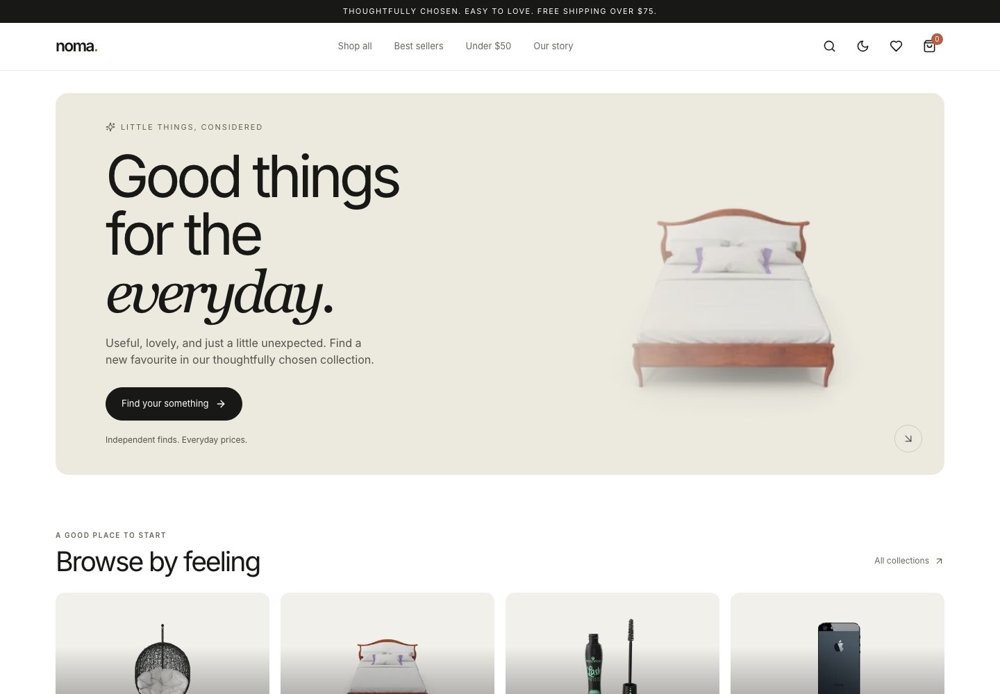
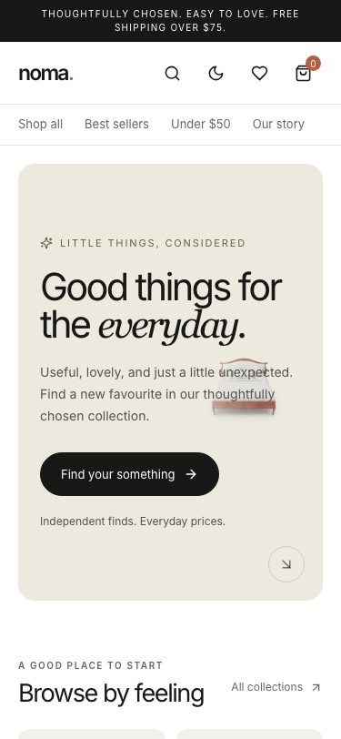
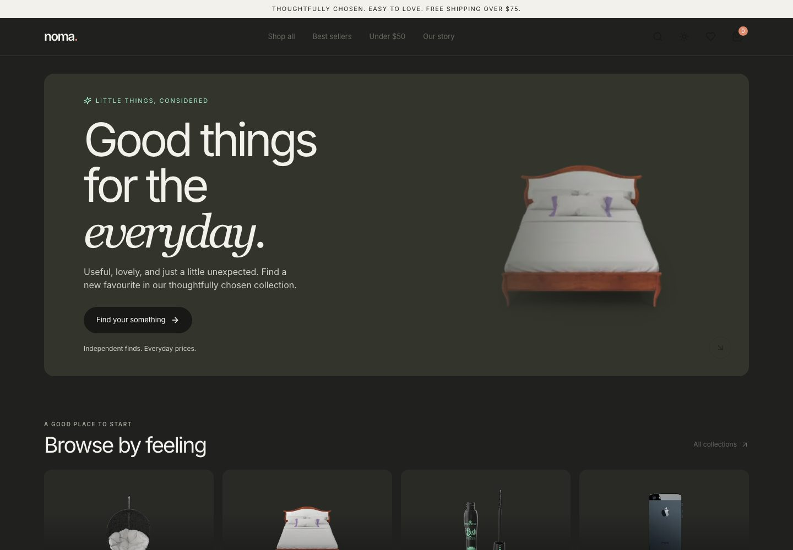
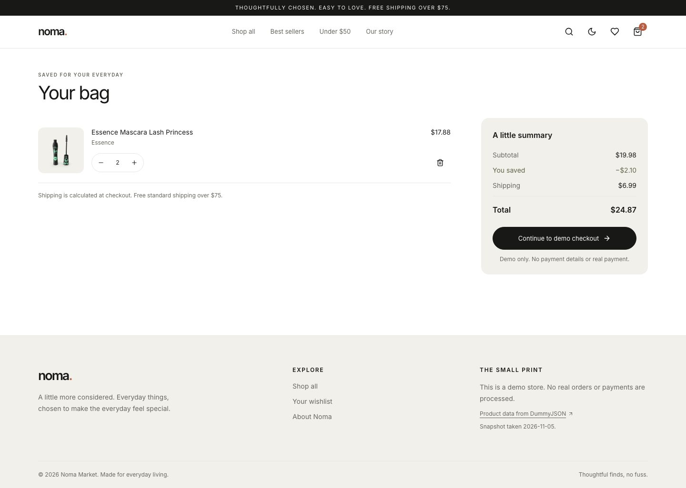
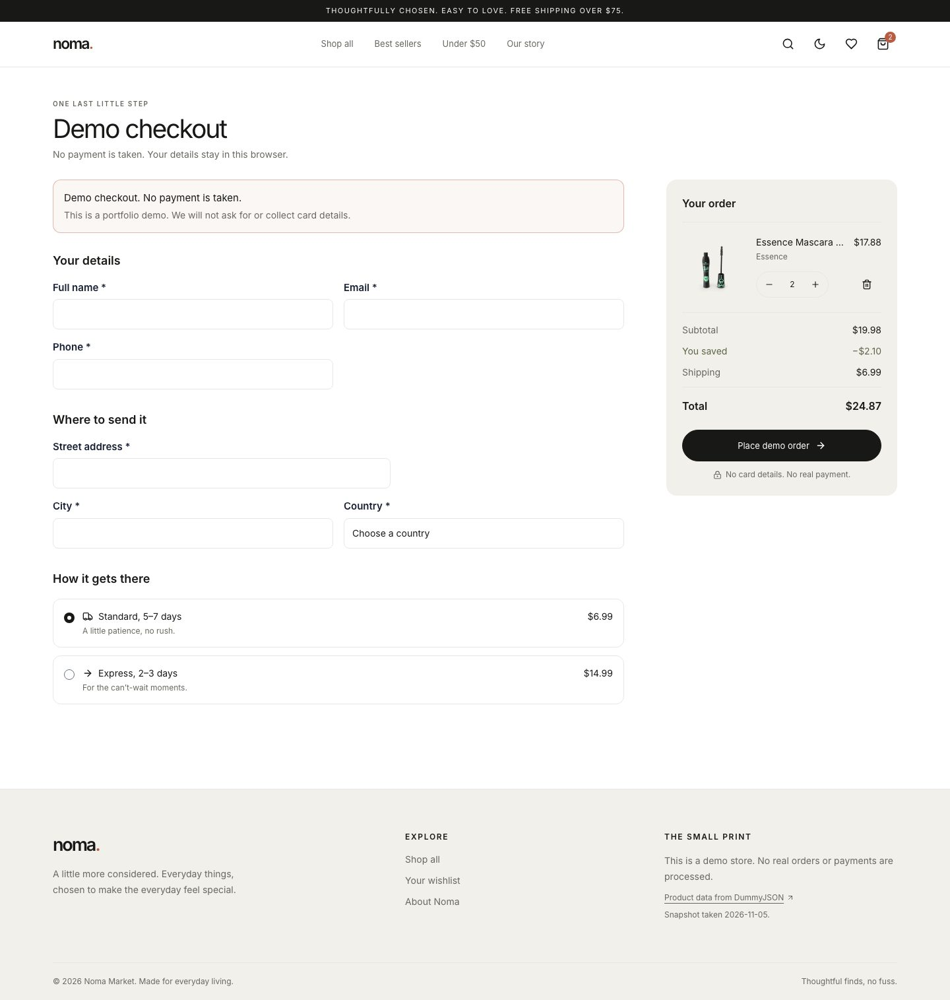

# Noma Market


A fast, responsive demo shop for thoughtfully chosen everyday finds. Built with Next.js App Router, TypeScript, Tailwind CSS, Zustand and the `hamzehabbass-accessible-ui` component library.

> **Demo store only. No real orders or payments.** Checkout does not ask for card details. Cart, wishlist and the last demo order are saved only in the current browser.

**Repository:** [hamzehabbass/performed-optimised-storefront](https://github.com/hamzehabbass/performed-optimised-storefront).  
**Live site:** [hamzehabbass.github.io/performed-optimised-storefront](https://hamzehabbass.github.io/performed-optimised-storefront/). GitHub Actions builds and deploys `main`, then runs the live smoke test.

## What’s here

- Home page with featured collections, top-rated picks and deals.
- Searchable catalogue with category, price, rating, stock and sort controls; state is shareable in the URL.
- Statically generated product pages with keyboard/swipe gallery, stock status, reviews, wishlist and related finds.
- Persistent cart and wishlist, quantity controls, discount savings and shipping totals.
- Validated demo checkout, shipping choice and browser-saved order confirmation.
- Light/dark themes, responsive layouts, skip link, accessible labels, focus indicators, live announcements and reduced-motion support.
- Real DummyJSON product and category snapshots; the site does not depend on DummyJSON at runtime.

## Screenshots

Captured from the deployed site on 2026-11-05.

| Desktop home | Mobile home (375px) |
| --- | --- |
|  |  |

| Dark theme | Cart |
| --- | --- |
|  |  |



## Performance and accessibility

Lighthouse CLI 12.8.2 was run three times per page and device against the deployed Pages URL on 2026-11-05. Scores and lab metrics below are the median of those runs. LCP and TBT are lab measurements; Lighthouse does not provide field INP.

The production build generates 204 static routes. The local export is 24 MB on disk, including HTML, route data and assets; emitted JavaScript chunks total 1.0 MB before transfer compression. These build sizes are not Lighthouse or network-transfer measurements.

| Page | Device | Performance | Accessibility | LCP | CLS | TBT |
| --- | --- | ---: | ---: | ---: | ---: | ---: |
| Home | Mobile | 99 | 100 | 1.95 s | 0.000 | 2 ms |
| Home | Desktop | 100 | 100 | 0.46 s | 0.000 | 0 ms |
| Catalogue | Mobile | 95 | 100 | 2.85 s | 0.000 | 7 ms |
| Catalogue | Desktop | 100 | 100 | 0.68 s | 0.000 | 0 ms |
| Product | Mobile | 96 | 100 | 2.80 s | 0.000 | 3 ms |
| Product | Desktop | 100 | 100 | 0.58 s | 0.000 | 0 ms |

The export uses `next/image` with `unoptimized: true`, because GitHub Pages has no Next.js image-optimisation server. Images include intrinsic layout sizing, responsive `sizes`, lazy loading below the fold and priority hints for the hero and product lead image. The Inter font is self-hosted by `next/font` at build time.

The current suite has 18 unit/component tests and 15 Playwright scenarios. Automated axe checks cover the home, catalogue, product, cart (including its drawer) and checkout pages in light and dark themes. The post-deploy smoke test passed against the live Pages site. These checks complement — they do not replace — manual keyboard, screen-reader and real-phone testing.

## Data and architecture

- `data/products.json` is the lean 194-product catalogue snapshot; `data/products-full.json` holds product detail, images and reviews. Both were saved from the actual DummyJSON responses (including the verified string-array `/products/category-list` response).
- Pure filtering, URL parsing, discount and order-total logic lives in `lib/`.
- Next.js statically exports every product route from the committed snapshot. GitHub Pages uses the repository name as `basePath` and `assetPrefix`.
- Static Pages cannot create arbitrary order URLs after build, so checkout uses the generated static `/order/confirmation/` route and keeps the unique demo order id in the query string and browser-saved receipt.
- Zustand stores use explicit client-side rehydration to keep server and first-client markup consistent.
- The cart, wishlist and latest demo order use browser storage only; there are no accounts, server endpoints or payment integrations.
- `hamzehabbass-accessible-ui` supplies the accessible drawer, buttons, inputs and form field primitives.

## Run locally

Requires Node.js 20.9 or newer and npm (CI uses Node.js 24).

```bash
npm ci
npm run dev
```

Useful checks:

```bash
npm run lint
npm run typecheck
npm test
npx playwright install chromium
npm run build
npm run test:e2e
```

`npm run test:e2e` serves the static `out/` export locally. The purchase-flow test uses the committed product snapshot and exercises category filtering, product detail, cart persistence after reload and demo checkout. The deployed smoke test checks that the live home page and product cards render.

Refresh the committed data (requires network access):

```bash
npm run data:update
```

The update script checks the live response shapes before writing snapshots and removes reviewer email addresses. If DummyJSON changes shape or the download fails, the script exits with an explicit error. The snapshot was taken **2026-11-05**.

## GitHub Pages

Push this repository to the `main` branch and allow GitHub Actions to publish Pages. The workflow runs lint, type-checking, unit/component tests, the production build, end-to-end purchase flow and light/dark axe checks. On `main`, it rebuilds with the repository-specific base path, deploys to Pages and runs a smoke test against the deployment URL.

For a differently named repository, the workflow uses that repository’s name automatically. Set the repository description, topics (for example `nextjs`, `typescript`, `ecommerce`, `accessibility`, `performance`, `zustand`, `github-pages`) and profile pin in GitHub after creating it.

## Remaining release checks

- Test with a screen reader and a real phone; automated axe is not a substitute for either.
- Add the repository description, topics and website in GitHub’s About panel.
- PageSpeed Insights API requests were rate-limited during this run; the Lighthouse CLI measurements above are from the deployed URL.
